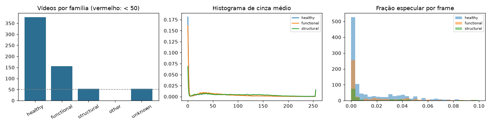

# Relatório do dataset — BAGLS

Gerado por `python -m laringopdi eda` (git c938262). Não edite à mão.

## Contagens

- Frames: **59250** (esperado ~59.250); vídeos: **640** (esperado 640)
- Vídeos RGB: 25 (todos são convertidos para cinza)
- Frames com máscara: 59250; com glote visível (máscara não vazia): 55286
- ID de sujeito nos metadados: não (só ID de vídeo)
- Split oficial (vídeos): {'training': 570, 'test': 70} — ignorado nos folds

### Por família

| family | videos | frames |
|---|---|---|
| healthy | 377 | 35500 |
| functional | 156 | 15150 |
| structural | 54 | 4900 |
| other | 0 | 0 |
| unknown | 53 | 3700 |

### Texto do status → família (revisão humana; regras em `configs/label_map.yaml`)

| disorder_raw | family | videos |
|---|---|---|
| `Muscle tension dysphonia` | functional | 105 |
| `Muscle tension dysphonia with M. thyroarythaenoideus atrophy` | functional | 10 |
| `Muscle tension dysphonia with vocal insufficiency and M. thyroarythaenoideus atrophy` | functional | 8 |
| `Vocal insufficiency and M. thyroarythaenoideus atrophy` | functional | 6 |
| `functional` | functional | 6 |
| `Muscle tension dysphonia with vocal insufficiency` | functional | 3 |
| `Laryngitis` | functional | 2 |
| `Paresis` | functional | 2 |
| `Posterior insufficient glottic closure` | functional | 2 |
| `laryngitis` | functional | 2 |
| `paresis` | functional | 2 |
| `spasmodic dysphonia` | functional | 2 |
| `Anterior insufficient glottic closure` | functional | 1 |
| `Hourglass-shaped insufficient glottic closure (high phonation)` | functional | 1 |
| `Insufficient glottic closure: posterior` | functional | 1 |
| `Irregular vibration anterior and middle portion of both vocal folds` | functional | 1 |
| `Posterior insufficient glottic closure (high phonation)` | functional | 1 |
| `Vocal fold atrophy with complete glottic closure` | functional | 1 |
| `healthy` | healthy | 376 |
| `None (higher phonation)` | healthy | 1 |
| `Muscle tension dysphonia with nodules` | structural | 10 |
| `Muscle tension dysphonia with contact granuloma` | structural | 4 |
| `edema` | structural | 4 |
| `Polyp` | structural | 3 |
| `Bilateral Reinke's edema (right more than left)` | structural | 2 |
| `Midmembranous swelling (mainly right vocal fold) with hourglass-shaped insufficient glottic closure` | structural | 2 |
| `Minimal anterior mucosal irregularity right vocal fold ` | structural | 2 |
| `Reinke's edema right vocal fold with hourglass-shaped insufficient glottic closure` | structural | 2 |
| `polyp` | structural | 2 |
| `scar` | structural | 2 |
| `Bilateral Reinke's edema` | structural | 1 |
| `Bilateral vergeture with bowed insufficient glottic closure` | structural | 1 |
| `Bowed/oval insufficient glottic closure (left more than right); stifness right vocal fold` | structural | 1 |
| `Cyst vocal fold left (posterior insufficient glottic closure) ` | structural | 1 |
| `Cyst vocal fold left with posterior insufficient glottic closure (high phonation) ` | structural | 1 |
| `Extreme polipoid pendulating edema obstructing almost complete glottis` | structural | 1 |
| `Fibrotic/stiff right vocal fold` | structural | 1 |
| `Lateral-posterior vocal fold cyst` | structural | 1 |
| `Lateral-posterior vocal fold cyst (high phonation)` | structural | 1 |
| `Post-resection of extreme polipoid pendulating edema right vocal folds; extreme polipoid pendulating edema obstructing almost complete glottis left vocal folds` | structural | 1 |
| `Reinke's edema right vocal fold (earlier it was bilateral)` | structural | 1 |
| `Right vocal fold polyp (with hourglass-shaped insufficient glottic closure)` | structural | 1 |
| `Right vocal fold polyp with contraleral edema ` | structural | 1 |
| `Vocal fold nodules` | structural | 1 |
| `Vocal fold nodules (high phonation)` | structural | 1 |
| `Vocal fold nodules with hourglass insufficient glottic closure and teleangectasia` | structural | 1 |
| `Vocal insufficiency and contact granuloma` | structural | 1 |
| `carcinoma` | structural | 1 |
| `cyst` | structural | 1 |
| `leucoplacia` | structural | 1 |
| `papilloma` | structural | 1 |
| *(vazio)* | unknown | 50 |
| `None (half year after diagnosis of small vocal nodules)` | unknown | 1 |
| `None (half year post-phonomicrosurgery for polipoid mid-membranous lesions)` | unknown | 1 |
| `None (one year after presumption of a pseudocyst/sulcus in left vocal fold)` | unknown | 1 |

### Tarefas (vídeos)

| tarefa | healthy | disorder | structural | functional |
|---|---|---|---|---|
| A | 377 | 210.0 | 0.0 | 0.0 |
| B | 377 | 0.0 | 54.0 | 0.0 |
| C | 377 | 0.0 | 54.0 | 156.0 |

### Intensidade (até 3 frames por vídeo)

| family | mean | spec_frac | seg_area |
|---|---|---|---|
| functional | 56.2395 | 0.0168 | 0.0067 |
| healthy | 55.4042 | 0.0165 | 0.007 |
| structural | 90.7881 | 0.019 | 0.0091 |

### Por `meta_camera` (vídeos)

| meta_camera | functional | healthy | structural | unknown |
|---|---|---|---|---|
| FASTCAM Mini AX100 type 540K-C-16GB | 0 | 0 | 0 | 20 |
| HERS 5562 Endocam Wolf | 34 | 28 | 17 | 0 |
| KayPentax HSV 9700 (Photron) | 0 | 16 | 0 | 0 |
| KayPentax HSV 9710 (Photron) | 122 | 333 | 37 | 3 |
| Phantom v210 | 0 | 0 | 0 | 30 |

## Amostragem de frames

- 5870 frames de 587 vídeos (até 10 por vídeo; critério: has_seg & seg_area>0 & task_a_label>=0; linspace por ordem de frame)

## Vídeos quase-duplicados (pHash do frame central + SSIM)

- Hamming ≤ 6, SSIM ≥ 0.85: 1 pares candidatos, 0 confirmados; 587 grupos (0 com mais de 1 vídeo; maior: 1)

## Splits (StratifiedGroupKFold por vídeo, 5 folds) — vídeos

| fold | part | functional | healthy | structural |
|---|---|---|---|---|
| 0 | test | 31.0 | 76.0 | 11.0 |
| 0 | train | 107.0 | 258.0 | 37.0 |
| 0 | val | 18.0 | 43.0 | 6.0 |
| 1 | test | 31.0 | 76.0 | 11.0 |
| 1 | train | 107.0 | 258.0 | 37.0 |
| 1 | val | 18.0 | 43.0 | 6.0 |
| 2 | test | 31.0 | 75.0 | 11.0 |
| 2 | train | 107.0 | 259.0 | 37.0 |
| 2 | val | 18.0 | 43.0 | 6.0 |
| 3 | test | 32.0 | 75.0 | 10.0 |
| 3 | train | 106.0 | 258.0 | 38.0 |
| 3 | val | 18.0 | 44.0 | 6.0 |
| 4 | test | 31.0 | 75.0 | 11.0 |
| 4 | train | 107.0 | 259.0 | 37.0 |
| 4 | val | 18.0 | 43.0 | 6.0 |

## Famílias com menos de 50 vídeos

Nenhuma.
